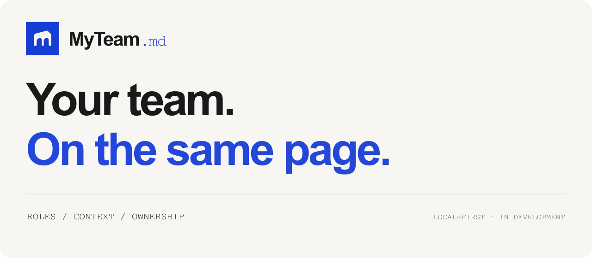

# Give your coding agents a team.

One session plans. Another builds. A third reviews. You’re the one remembering who owns what.

MyTeam.md is a local-first engineering workspace in development, designed to keep roles, project context, and ownership clear across coding-agent sessions. **A new session shouldn’t mean a new team.**

**[Documentation](https://github.com/saleemhamo/myteam-md/blob/main/docs/README.md) · [Roadmap](roadmap.html) · [UI preview](ui-preview.html) · [Setup guide](setup.html) · [Plugins](plugins.html)**

> **Current phase: R0 — local setup with experimental previews.** Create and check a private team workspace, export Claude/Codex setup-plugin folders, read selected project evidence, and resume saved onboarding reports for recorded chats in a read-only local UI. Live boards, connected accounts, agent execution, and on-call automation remain planned. No alpha release or npm package has been published.

## Meet the team. Find your next step.

**[Enter the interactive team desk](https://saleemhamo.github.io/myteam-md-docs/#team)** — meet Leo, Iman, Maya, Nora and Ada. Choose what you need, follow a practical checklist, and hand off to the next teammate. The docs provide working controls and links; the illustrated guides do not execute agents.

GitHub renders this README as a document. The team’s hover, keyboard, touch and motion experience lives on the documentation site.

## Quickstart

From this checkout, with **Node.js 22 or newer**:

```sh
node bin/myteam.mjs init
```

Choose `demo`, name your team, and select a new private workspace directory. Review the plan before creating it. No dependency installation, credentials, or model calls are needed.

The wizard creates `MYTEAM.md`, a workspace profile, and three starter roles: **lead**, **engineer**, and **qa**. Choose manual, Codex, Claude Code, or mixed runtime preferences; setup records the configuration without starting agents.

Follow the [setup guide](setup.html) for diagnostics and local package installation, or use the [test checklist](setup-test.html) to verify your first workspace.

For a visual tour, run `node ui/server.mjs` from this checkout and open the printed local address. For your saved onboarding record, run `node bin/myteam.mjs ui --workspace /path/to/private-workspace`; the local CLI archive now includes this view. Follow [project discovery and chat resume](https://github.com/saleemhamo/myteam-md/blob/main/docs/host-integration.md) to select a recorded coordinator or engineer chat. The [UI guide](ui-preview.html) distinguishes local reports from the synthetic tour. Changes go through the main MyTeam.md chat and [onboarding CLI](https://github.com/saleemhamo/myteam-md/blob/main/docs/onboarding-state.md); the browser does not edit them. The [plugin guide](plugins.html) explains exporting optional setup guidance for Claude and Codex.

## A team you can read

`MYTEAM.md` describes the project’s purpose, responsibilities, working agreements, and context references. Start with the [synthetic team example](team-example.html), then adapt it to your project.

Provide this document explicitly when beginning work. It is a proposed convention: Codex and Claude Code do not load it automatically, and your repository’s `AGENTS.md` and `CLAUDE.md` remain authoritative.

## Explore the project

- [Team journeys](https://github.com/saleemhamo/myteam-md/blob/main/docs/team-journeys.md) — one main chat, setup through acceptance, and implementation slices.
- [Team handbook](https://github.com/saleemhamo/myteam-md/blob/main/docs/team-handbook.md) — team size, profiles, skills, research and operating agreements.
- [Project-aware onboarding](https://github.com/saleemhamo/myteam-md/blob/main/docs/project-onboarding-contract.md) — the proposed discovery-first flow and questions for missing context.
- [Product and onboarding](https://github.com/saleemhamo/myteam-md/blob/main/docs/product-and-onboarding.md) — intended experience and architecture.
- [Runtime compatibility](https://github.com/saleemhamo/myteam-md/blob/main/docs/runtime-compatibility.md) — roles, sessions, and provider choices.
- [GitHub integration](github.html) — tested observation logic; live transport is pending.
- [Secrets setup](secrets.html) — connection planning and the 1Password evaluation path.
- [Readiness and rollout](https://github.com/saleemhamo/myteam-md/blob/main/docs/readiness-and-rollout.md) — acceptance gates behind the roadmap.
- [Releases and publishing](https://github.com/saleemhamo/myteam-md/blob/main/docs/releases.md) — version tags, draft releases, and package channels.
- [Prior art](https://github.com/saleemhamo/myteam-md/blob/main/docs/prior-art.md) — existing projects and lessons informing the design.
- [Open decisions](https://github.com/saleemhamo/myteam-md/blob/main/docs/open-decisions.md) — remaining choices and evidence needed for release.
- [Branding](https://github.com/myteam-md/branding) — Same Page identity and reusable assets.

<details>
<summary>Development and contribution notes</summary>

The repository is private. MyTeam.md is a working name; licensing and public release remain pending. Examples are synthetic. Keep credentials, company data, personal instruction libraries, and raw conversations outside the reusable product.

[Credentials and access](https://github.com/saleemhamo/myteam-md/blob/main/docs/credentials-and-access.md) describes proposed security boundaries; runtime isolation is not a verified protection. For changes, follow [Contributing](https://github.com/saleemhamo/myteam-md/blob/main/CONTRIBUTING.md), [AGENTS.md](https://github.com/saleemhamo/myteam-md/blob/main/AGENTS.md) and the [repository checks](https://github.com/saleemhamo/myteam-md/blob/main/docs/ci.md). Maintainers should read the [Git account workflow](https://github.com/saleemhamo/myteam-md/blob/main/docs/git-accounts.md) before publishing.

</details>
