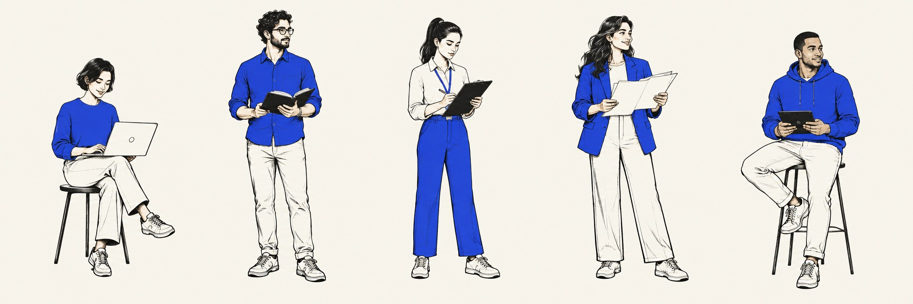
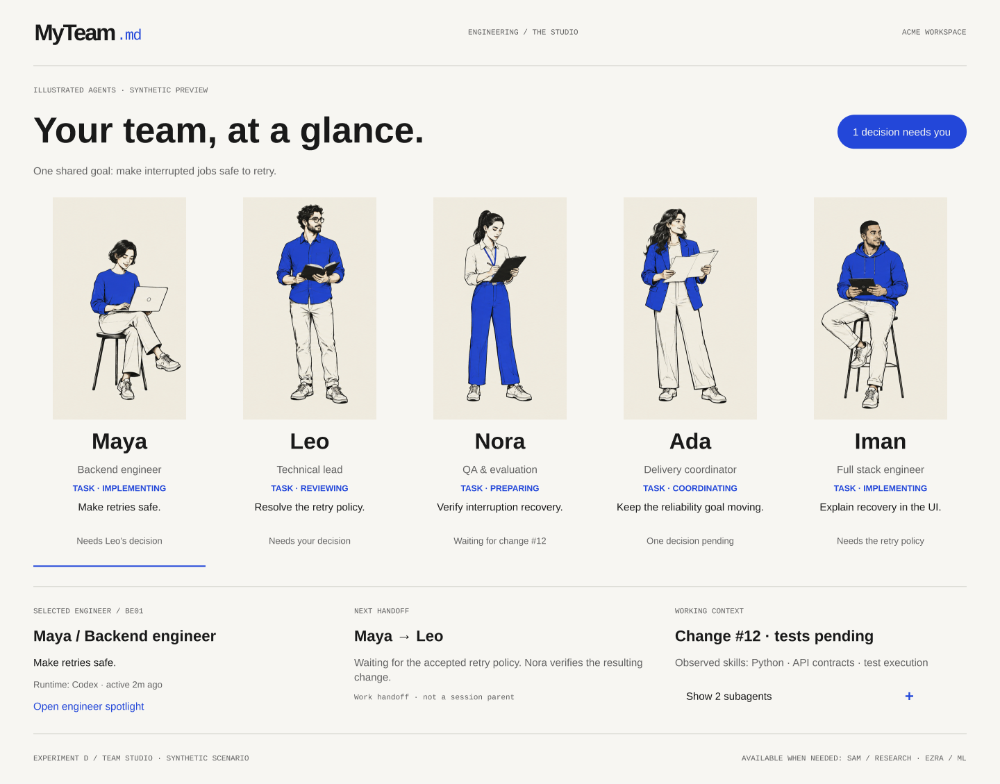
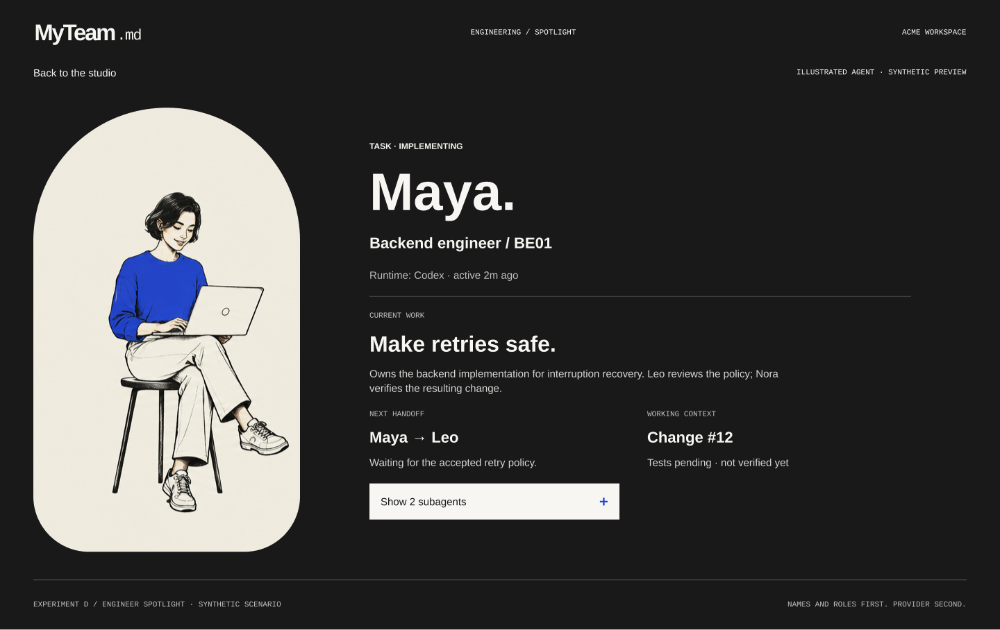

# Your team, at a glance

**Design concept · synthetic team and work.** The illustrated direction extends MyTeam.md’s Same Page identity: warm paper, dark ink, blue accents and simple type. The existing logo and “Your team. On the same page.” remain the foundation.

These are static design explorations, not screenshots of shipped functionality. The final screen direction is still open. For what you can run today, see the [local UI preview](ui-preview.html) and [setup guide](setup.html).

## Team Studio

Studio puts the team in one view: name, role, current task and blocker. Selecting an engineer reveals the next handoff and working context. Runtime activity is separate from task progress; supporting agents stay behind a disclosure.

*Static concept. [Open Studio at full size](../assets/team-studio-concept.png).*

In this fictional scenario, Maya works on retry safety; Leo reviews the policy; Nora prepares verification; Ada coordinates the decision; Iman explains recovery in the UI. Maya’s handoff to Leo depends on an accepted retry policy. The labels “active 2m ago,” “tests pending,” and “observed skills” are sample design content, not observations of a running system.

## Engineer Spotlight

Spotlight gives one engineer space for identity, current work and the next handoff. The dark background provides a focused detail view while retaining the same illustration and typography.

*Static concept. [Open Spotlight at full size](../assets/engineer-spotlight-concept.png). The depicted controls do not perform actions here.*

## What this direction should preserve

- Names and responsibilities come first; a runtime is an attribute of an engineer.
- Portraits help recognition, while task, blocker and next action remain readable without the artwork.
- Task status, session activity, review and CI evidence stay separate.
- Missing observations must appear as unavailable, never as invented activity or zero usage.
- Illustrations represent fictional agent roles, not human employees or proof that agents are running.

A production interface still needs responsive layouts, accessible controls and real data contracts. These exports do not validate those behaviors or approve the broader onboarding journey.

## Design sources

The original MyTeam artwork and editable layouts are in the [MyTeam Design Lab: Team Studio](https://www.figma.com/design/ejdWnLEp1a87SZe892WjiG/MyTeam-Design-Lab?node-id=21-149) and [Engineer Spotlight](https://www.figma.com/design/ejdWnLEp1a87SZe892WjiG/MyTeam-Design-Lab?node-id=21-236). Figma access may be required. The repository copies above let readers view the concepts without a design-tool account.

The concept images were exported on 19 November 2026 from nodes `21:149` and `21:236`; the team strip reuses the original illustrated artwork. These are documentation assets, with no private project data or live activity. The [separate branding repository](https://github.com/myteam-md/branding) remains the home of the core identity.
